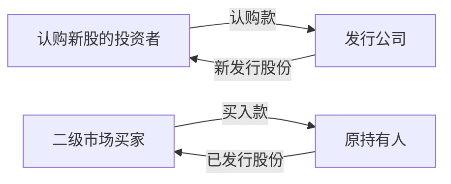

# 01 企业为什么需要金融：从一家面包店开始

[首页](../README.md) · [下一篇：资产、负债与权益](02-资产负债股权与债权.md)

## 学前需要什么，学完能做什么

不需要金融知识。准备纸和笔，把“谁把钱交给谁”画成箭头。学完应能解释融资、投资、股票、债券、一级市场和二级市场之间的基本关系。本篇先建立直觉，上市制度以后展开。

## 1 为什么一家赚钱的小店仍然需要钱

海港面包公司想扩店：设备要先付款，面粉要先购买，员工每月领薪水，而顾客的钱会在未来陆续进来。这是时间差。金融把今天有闲钱的人和今天需要钱的人联系起来，并约定未来怎样分享收益、承担损失。

“生意赚钱”也可能只是账面上有利润。如果面包已经送给酒店、酒店两个月后才付款，公司今天仍需要现金支付工资。日常经营缺现金与经营长期亏损是两个问题：前者可能靠周转解决，后者不能靠不断借款自动治愈。

把金融理解成帮助资金跨人、跨时间流动的安排。银行、证券市场、基金等是不同渠道。金融产品的名称很多，但先问三个问题就能抓住骨架：我给谁钱？我取得什么权利？如果事情不顺利，谁先承担损失？

## 2 借钱与卖出部分所有权

创办人自有 600,000，另外还缺 400,000。第一种方法是向银行借款。银行成为债权人：通常按合同收利息，并在到期时要求还本，不因面包卖得特别好就自动取得全部经营收益。公司则承担到期支付义务。

第二种方法是请新合伙人投入 400,000，换取约定的股份。合伙人成为股东，分享未来剩余收益，也承担生意失败后可能收不回投入的风险。股东获得的不是一张“每年保证付款”的凭证。

| 观察角度 | 借款／债权 | 股份／股权 |
|---|---|---|
| 最先看什么 | 约定还本付息的能力 | 企业长期创造剩余价值的能力 |
| 收益安排 | 合同约定利息等 | 股息与股份价格变化 |
| 是否通常有到期日 | 通常有，永续工具另论 | 普通股通常没有 |
| 经营很好时 | 收益一般仍受合同限制 | 可能分享较多上涨空间 |
| 清算时 | 通常先于普通股受偿 | 普通股通常处于剩余位置 |

这些是基础比较。具体债务有担保、优先级、可转换条款等差异；普通股与优先股也不相同。现在只要先分清“合同债权”与“剩余所有权”。

## 3 证券是什么

证券可以理解为把某些财产权利做成可识别、可持有、可转让的工具。股票代表公司股权；债券代表约定的债权；基金单位代表对投资组合的权益。纸张只是历史上的记录载体，权利本身可以通过电子系统记录。

不要把“可转让”理解成“随时一定有人接手”。你拥有一件有价值的东西，不代表下一秒就能按理想价格卖出。这是流动性问题。上市提供有组织的交易场所，也不能保证没有亏损。

## 4 一级市场和二级市场的第一张图

文字读法：公司发行新股时，新股认购资金进入公司；原持有人转卖旧股时，买家的款项进入卖家。公开发售中也可能包含旧股出售，因此实际要查看发行结构，不能只看“IPO”三个字就判断所有钱都归公司。

为什么二级市场仍帮助公司融资？投资者若知道将来较容易转让，今天可能更愿意认购。这个间接作用与“每次股票买卖都给公司一笔钱”不同。

## 5 投资、储蓄、交易与投机

储蓄侧重保留购买力和支付能力；投资把资源投入预期能带来未来收益的资产；交易强调买卖行为；投机通常更依赖对价格变化的判断。这些词在生活中边界会重叠。读题时应看具体权利、现金流和风险，不能仅凭标签判断安全程度。

风险是结果可能偏离预期，也包括永久损失、短期波动、卖不出去、对方不履约、购买力下降。收益则要说明衡量时间、投入本金和是否扣除成本。“赚 1,000 元”离开本金和持有时间，信息不足。

## 6 两个初学者容易忽略的边界

其一，公司和股东是不同的主体。小林买了股票，不会因此直接拥有公司银行账户里的对应现金，也不能随时走进店里拿走面包机。其二，市场价格与企业经营相互影响但不是同一件事。好公司也可能买得太贵；股票上涨也不证明公司现金流已改善。

学习时可以反复问：这是资产本身创造的现金，还是另一个人愿意出的价格？两种收益机制可能同时存在，也可能暂时分离。

## 7 主动回忆

1. 面包公司收入增长，但顾客赊账期限变长，为什么可能缺现金？
2. 公司发行新股筹得 200 万，小林后来从小周买走这些股票，哪一笔钱进入公司？
3. 买入普通股后，公司今年没有派息，能否直接推断公司违反了与股东的固定付息合同？

自测解析

1. 收入确认与收款时间不同，现金要先支付成本；应看现金流和应收账款。增长甚至可能占用更多营运资金。
2. 新股发行认购款进入公司；转卖旧股的买入款进入小周。发行费用及旧股出售结构另算。
3. 不能。普通股股息不是债券式固定合同利息，要看适用法律、公司状况及派息决策。

## 回看与下一步

金融首先解决资金和时间的安排；股票与债券安排不同权利；一级与二级市场先看资金流向。现在画一张自己的图，再读下一篇。有关统一数字见[案例表 A、B](../08-复习工具/04-海港面包公司案例数据.md)，术语见[术语表](../08-复习工具/01-中英术语表.md)。
