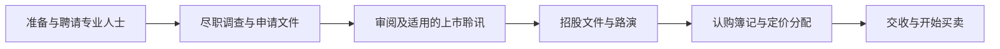

# 01 上市与发行：公司怎样向市场集资

[首页](../README.md) · [下一篇](02-上市规则专业人士与披露.md)

## 学习目标

解释 IPO、上市、发行新股、出售旧股及上市方法，能画出简化发行流程并说明上市利弊。先理解一级与二级市场以及股东权利。

## 1 上市和融资是相关但不同的动作

IPO 是首次公开招股；上市 Listing 是证券获准在有关交易所买卖。发行新股筹资经常与上市一同发生，但上市也可能通过介绍方式进行，不一定同时公开发行新股。已上市公司以后还可以再次融资。

实际 IPO 可能同时有新股与出售股东旧股。新股款在扣除相关费用后归公司；旧股出售所得归出售股东。研究招股文件先找“发售结构”和“所得款项用途”。

## 2 为什么上市，又要付出什么

上市有助于筹集资金、提供股份流动性、提高知名度、改善融资渠道，并可能让股份成为收购对价或员工激励工具。对早期股东而言，也可能提供退出路径，但须考虑禁售等限制。

成本包括上市及持续合规费用、信息披露、管理层时间、股权摊薄、公众监督及市场短期压力。上市不等于监管者保证企业值得购买，也不保证股价高于发行价。

## 3 简化流程：先审查，再宣传和定价

文字读法：公司先准备资料并接受专业核查，申请经过交易所审阅及适用程序，再向投资者提供文件、推介、收集订单，完成定价分配和交收。现实中各环节会交错，流程图不是每一上市类别的法定时间表。

上市聆讯不是投资回报认证；路演是沟通业务、风险和发行安排，不能代替招股文件。询价簿记反映需求，但订单可能受价格条件等影响，不能把意向完全视作不可撤回现金。

## 4 发售、配售与介绍

公开发售面向符合条件的公众投资者；配售一般通过中介向选定投资者分配，受适用规则限制；介绍上市通常不同时向市场募集新资金。供股属于已上市公司的后续融资安排，见公司行动讲义。

这些方法的对象、资金流、文件和批准程序不同，不能因为都能出现上市股份就视为同一流程。记忆时用四列：谁卖、卖给谁、是否发新股、钱归谁。

## 5 用案例 B 看摊薄

原有 800 万股，公司以每股 10 元发行 200 万新股，筹得 2,000 万，总股数 1,000 万。原股东比例从 100% 下降到 80%。这是持股比例摊薄。

但比例下降不自动代表经济价值下降 20%，因为公司同时收到新资金。发行价格、资金用途、费用及未来项目回报都会影响每股价值。每股盈利也可能被摊薄，但要看新增利润与新增股份的关系。

## 6 主板与 GEM 的学习方式

主板与 GEM 有不同的适用条件和持续要求，不能简单记成“好公司和坏公司”。成长企业、行业特征与财务测试需具体判断。生物科技等特殊上市框架也可能有专门规定。

本文不把海港面包公司的教学金额作为上市门槛。涉及定量要求应查对应版本规则及手册，详见[下一篇](02-上市规则专业人士与披露.md)。

## 7 电子认购、FINI 与无纸证券

电子 IPO 指通过电子渠道处理认购等安排；FINI 是新股发行交收流程相关平台；无纸证券 USM 涉及证券法律所有权以电子形式持有及转让。电子下单、电子认购和以本人名义无纸持有是不同层次。

截至 2026-10-30，证监会公布 USM 将于 2026-11-16 实施，应写成未来生效安排，不写成已经完成。适用证券、过渡和发行人参加日期有范围限制。[证监会 USM 专页](https://www.sfc.hk/en/Rules-and-standards/Uncertificated-Securities-Market)

## 自测

1. IPO 中投资者支付 1 亿，其中新股 8,000 万、旧股 2,000 万，未计费用，公司取得多少？
2. 介绍上市是否必定募集新资金？
3. 原股东 800 万股，新发 200 万股，原股东比例多少？这是否直接证明价值减少 20%？

解析

1. 8,000 万；旧股部分归出售股东。
2. 不必定；介绍上市通常不同时募资。
3. 80%；不能只看比例推断价值，需要考虑新增资金和发行条件。

回看：上市资格、发行结构与投资价值分别分析。统一数字见[案例 B](../08-复习工具/04-海港面包公司案例数据.md)。
